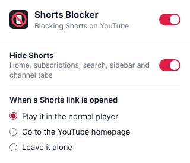

# Shorts Blocker for YouTube

A small Chrome extension that takes YouTube Shorts out of YouTube. Shorts disappear from your feeds, search results and sidebar, and any Shorts link you open plays in the normal video player instead of the endless swipe feed.



## What it does

- **Hides Shorts everywhere:** shelves on the home page, subscriptions, search results, the watch-page sidebar, channel pages and history; the Shorts entry in the sidebar; the Shorts search filter chip; the Shorts tab on channel pages; Shorts in notifications. Also covers `m.youtube.com`.
- **Redirects Shorts links:** `youtube.com/shorts/ID` opens as `youtube.com/watch?v=ID`, or sends you to the homepage if you prefer. The `/shorts` feed goes to the homepage and a channel's Shorts tab goes to its Videos tab.
- **One-click pause:** switch everything off from the toolbar popup. The icon shows an "off" badge while paused.

No tracking, no network requests, no data leaves your browser. Settings are stored with `chrome.storage.sync`.

## Install

The extension isn't on the Chrome Web Store, so you load it yourself (takes a minute):

1. Download this repo: **Code → Download ZIP**, then unzip it (or `git clone` it).
2. Open `chrome://extensions` in Chrome.
3. Turn on **Developer mode** (top right).
4. Click **Load unpacked** and pick the folder that contains `manifest.json`.
5. Pin the extension from the puzzle-piece menu if you want the toggle handy.

Works in any Chromium browser that supports Manifest V3: Chrome, Edge, Brave, Opera, Vivaldi.

To update after pulling new changes, hit the reload icon on the extension's card in `chrome://extensions`.

## Settings

| Setting | Options |
| --- | --- |
| Master switch | On / off (top-right toggle in the popup) |
| Hide Shorts | Hide Shorts shelves, cards, tabs and sidebar entry |
| When a Shorts link is opened | Play it in the normal player · Go to the YouTube homepage · Leave it alone |

## How it works

| Part | File | Job |
| --- | --- | --- |
| Hiding | `src/content.css` | CSS rules that hide Shorts components. All scoped to `html[data-ysb-hide]`, so turning the feature off restores the page instantly. |
| Content script | `src/content.js` | Sets that attribute from your settings, catches clicks on Shorts links and YouTube's in-page navigation, and flags elements that can only be recognised by their "Shorts" label. |
| Redirect rules | `rules/*.json` | `declarativeNetRequest` rules that rewrite Shorts URLs before the page loads (typed URLs, links from other sites, new tabs). |
| Service worker | `src/background.js` | Switches the redirect rulesets on and off to match your settings and sets the toolbar badge. |
| Popup | `src/popup.*` | The settings panel. |

### Permissions

- `storage`: to save your settings.
- `declarativeNetRequest` + access to `youtube.com`: to redirect Shorts URLs and hide Shorts on YouTube pages. The extension runs on no other site.

## When YouTube changes its layout

YouTube renames its page components every so often, which can let Shorts creep back in somewhere. To fix it:

1. Right-click the Shorts element → **Inspect**.
2. Find its outer element (tag names look like `ytd-…`, `yt-…` or `ytm-…`).
3. Add a selector for it to `src/content.css`, scoped with `html[data-ysb-hide]` like the others.
4. Reload the extension and open a pull request.

## Development

There are no build steps. Edit the files, then reload the extension.

End-to-end tests load the extension in headless Chrome and point `youtube.com` at a local mock page (`tests/mock_youtube.py`), then check hiding, all redirect modes, settings changes and the popup:

```bash
pip install playwright
playwright install chromium
./tests/run.sh
```

Set `CHROME_PATH` to use a specific Chrome for Testing or Chromium build. (Branded Google Chrome 137+ no longer allows loading extensions from the command line, so use Chromium or Chrome for Testing.)

## Project structure

```
manifest.json          Extension manifest (MV3)
src/
  defaults.js          Default settings, shared by every script
  content.js           Content script
  content.css          Hiding rules
  background.js        Service worker
  popup.html/.css/.js  Settings popup
rules/                 declarativeNetRequest redirect rulesets
icons/                 Toolbar and store icons
tests/                 End-to-end tests
```

## License

[MIT](LICENSE). Not affiliated with or endorsed by YouTube or Google.
